<p align="center">
  <a href="https://ruvelo.github.io/wp-comment-subscriptions/">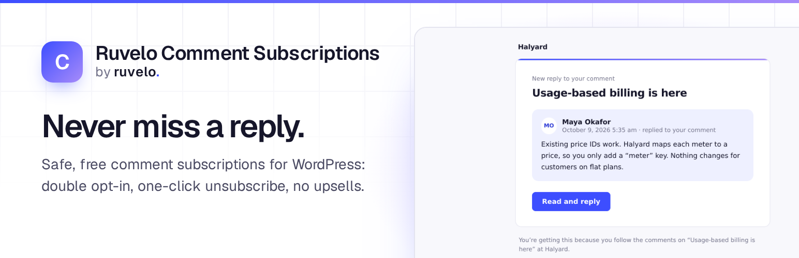</a>
</p>

<p align="center">
  <a href="https://playground.wordpress.net/?blueprint-url=https://raw.githubusercontent.com/Ruvelo/wp-comment-subscriptions/main/blueprint.json"><strong>Try it in Playground</strong></a> &nbsp;&nbsp;&nbsp;
  <a href="https://ruvelo.github.io/wp-comment-subscriptions/"><strong>Website</strong></a> &nbsp;&nbsp;&nbsp;
  <a href="#for-developers"><strong>Developer guide</strong></a> &nbsp;&nbsp;&nbsp;
  <a href="CHANGELOG.md"><strong>Changelog</strong></a>
</p>

<p align="center">
  <a href="https://github.com/Ruvelo/wp-comment-subscriptions/actions/workflows/tests.yml"></a>
  
  
  
  
  <a href="LICENSE"></a>
</p>

# Ruvelo Comment Subscriptions

**Close the loop on every comment.** Readers tick a box under the comment form and get an email when someone replies to them, or when anyone comments on the post. Guests confirm by email first, every email has a one-click unsubscribe, and only approved comments are ever sent. It replaces Subscribe To Comments Reloaded, closed on WordPress.org in April 2026 for a security issue, and imports its data.

```
wp plugin install https://github.com/Ruvelo/wp-comment-subscriptions/releases/latest/download/ruvelo-comment-subscriptions.zip --activate
```

That's all: the options appear under your comment forms. Or click around [Halyard's blog in WordPress Playground](https://playground.wordpress.net/?blueprint-url=https://raw.githubusercontent.com/Ruvelo/wp-comment-subscriptions/main/blueprint.json) first: it runs in your browser.

## A quick tour

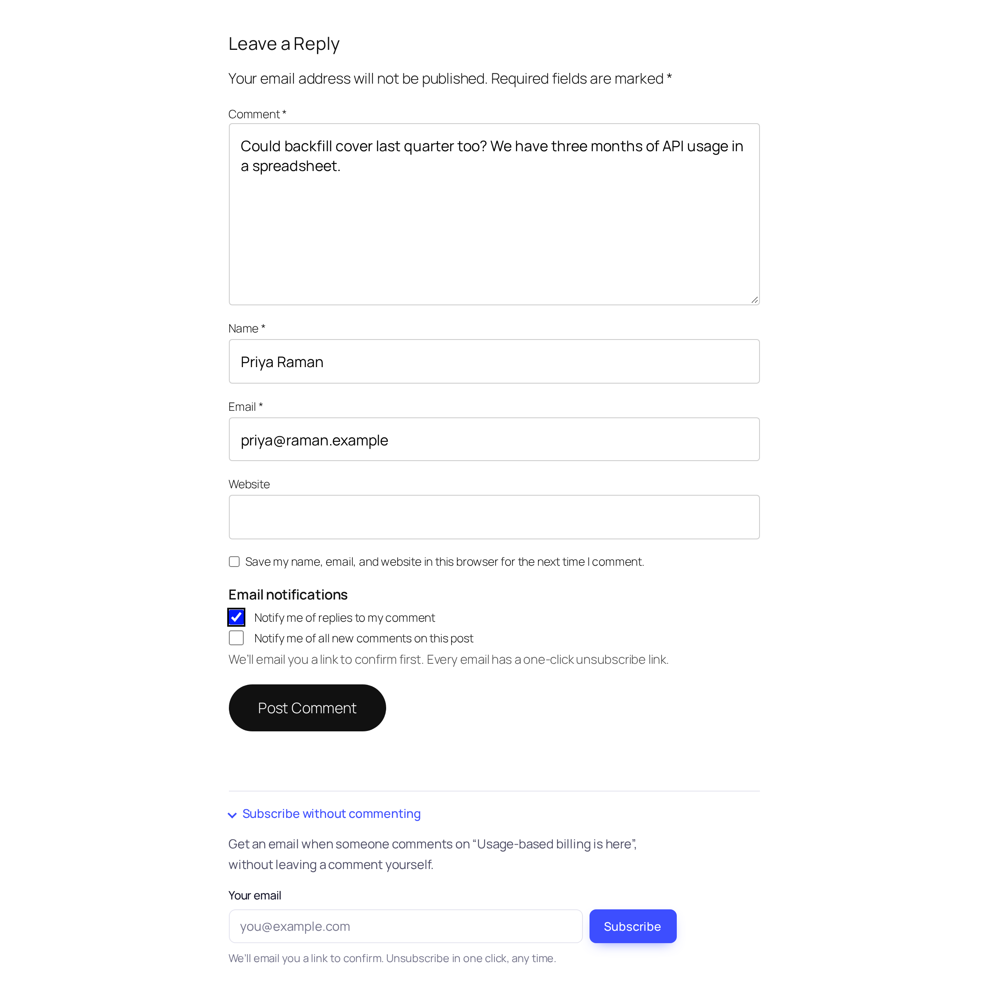

*The comment form: notify me of replies, or of all new comments, and "Subscribe without commenting".*

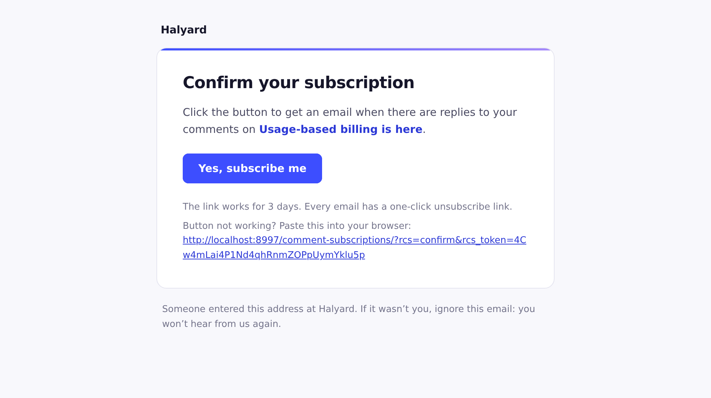

*The confirmation email (double opt-in).*

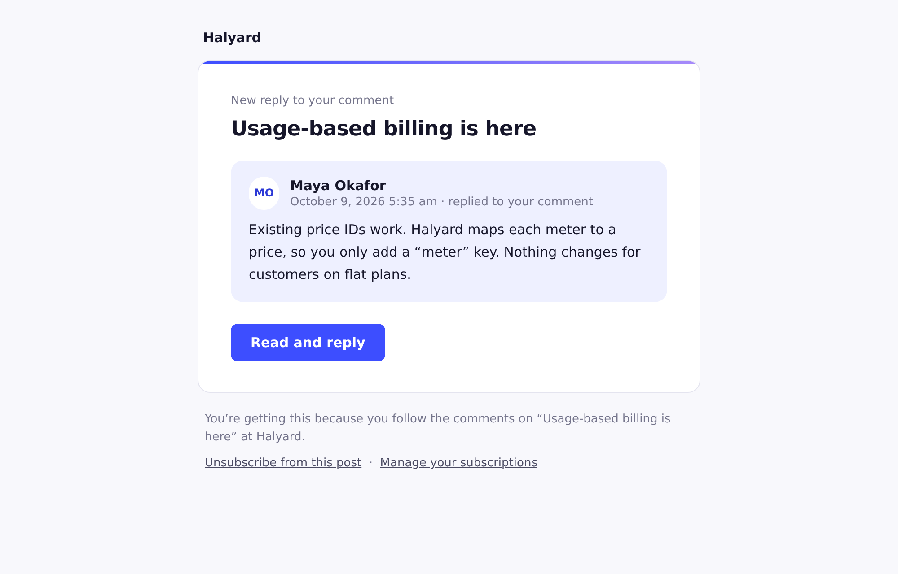

*A new-reply email with one-click unsubscribe.*

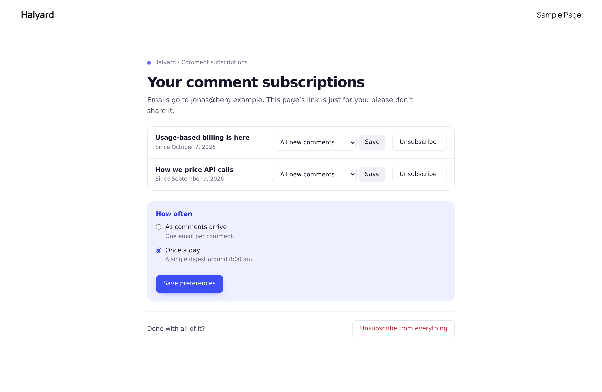

*The manage page, reached from a signed link: change, digest or unsubscribe.*

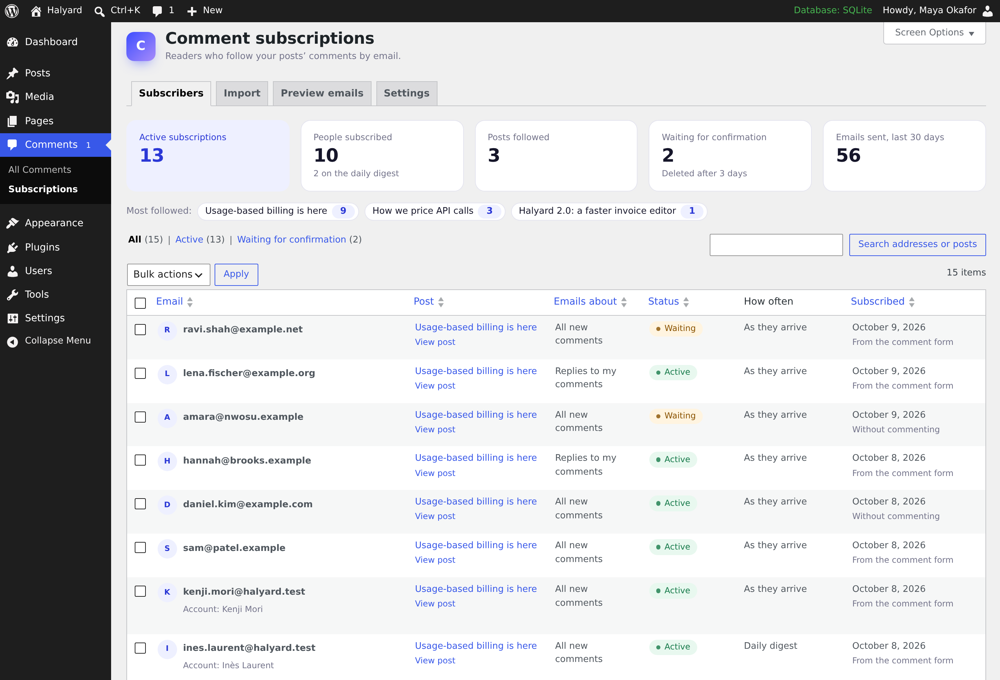

*Comments → Subscriptions: who follows what, search, bulk delete and stats.*

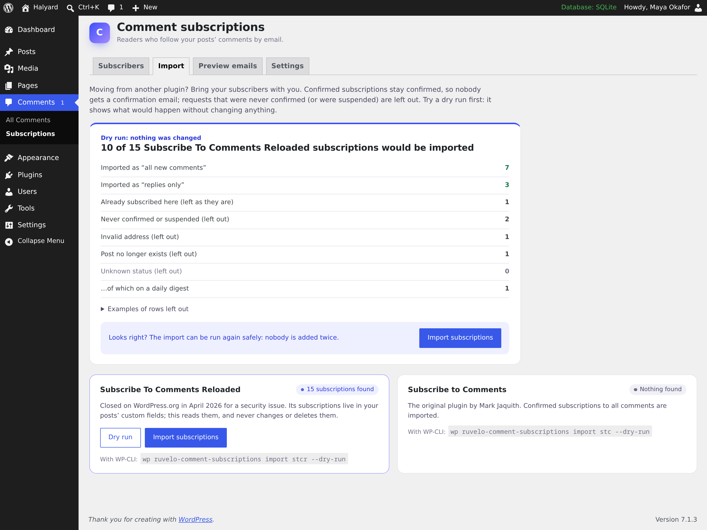

*Importing from Subscribe To Comments Reloaded, after a dry run.*

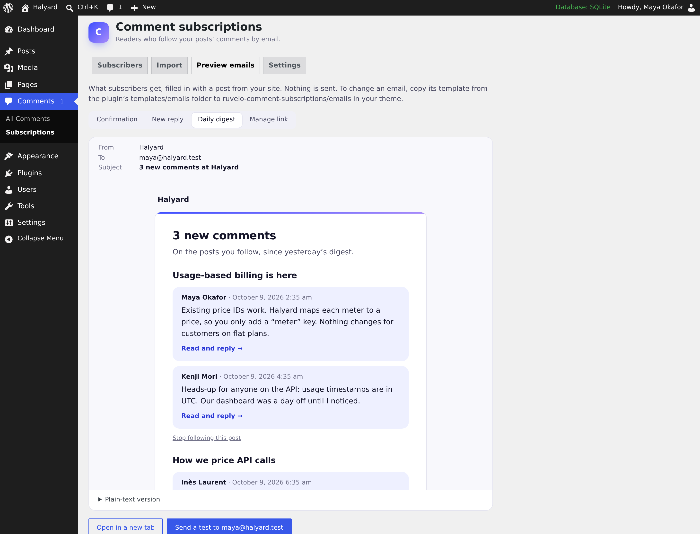

*Previewing every email without sending it.*

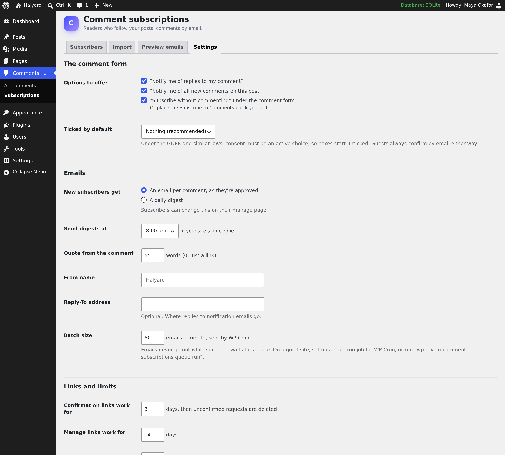

*Settings.*

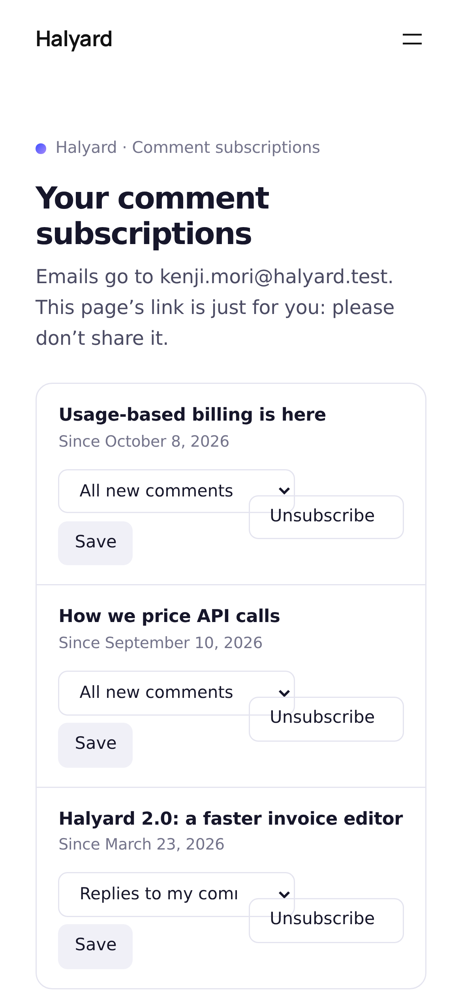

*On a phone.*

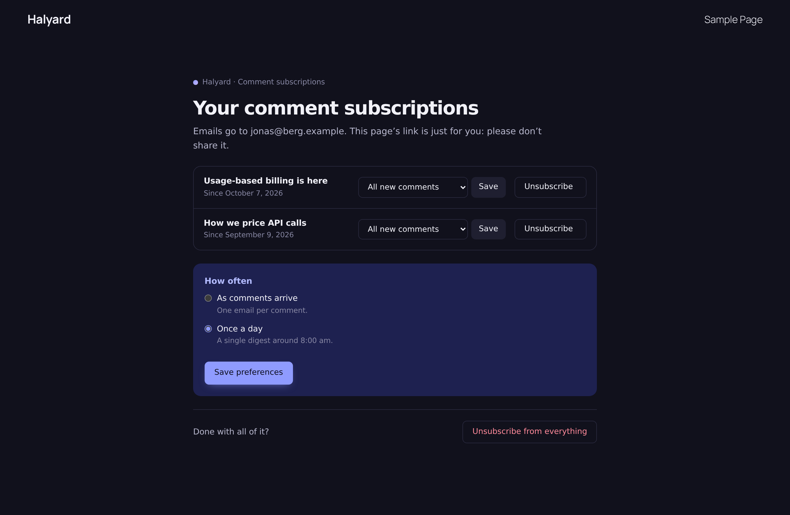

*In dark mode.*

## Features

- **Two choices in the comment form**, unticked by default, for the classic form and the Comments block; **Subscribe without commenting** through a form, the Subscribe to Comments block or `[ruvelo_subscribe]`.
- **Double opt-in** for guests, with expiring links and cleanup of unconfirmed requests. Signed-in users subscribe straight away. Nobody can learn who follows what.
- **Approved comments only**, checked again just before sending; sent in the background in WP-Cron batches; a **daily digest** for those who prefer it.
- **Clean emails**: HTML and plain text, system fonts, light and dark, comment quoted as text, `List-Unsubscribe` one-click headers, theme-overridable templates.
- **A manage page without an account**, reached from signed links, and a profile section for signed-in users.
- **Comments → Subscriptions**: who follows what, search, bulk delete, stats, email previews with test sends, and settings; per-post counts and a switch to turn subscriptions off.
- **Importer** from Subscribe To Comments Reloaded and Subscribe to Comments, with a dry run, never touching the old data.
- **Safe by design**: nonces, capability checks, `$wpdb->prepare()`, per-IP and per-address rate limits, a honeypot, hashed tokens and HMAC-signed links, and a GET never confirms or unsubscribes anyone (link scanners are harmless).
- **Privacy**: personal data export and erasure, a privacy policy paragraph, minimal data, unsubscribing deletes the record.
- **Works with Ruvelo Inbox**: signed-in subscribers can get notifications there instead of, or as well as, by email.

## Our promises

- **No nags, no upsells, no "pro" version.** No admin notices outside the plugin's own screens, no review requests, no ads, no redirect on activation.
- **No tracking and no remote requests.** Nothing phones home; no fonts, scripts, images or banners are loaded from anywhere else. The only emails sent are the ones your readers ask for.
- **Updates only from WordPress.org and Composer**, through WordPress's own updater. Ruvelo will never sell this plugin, its WordPress.org account or its users.
- **A clean uninstall.** Scheduled jobs are always cleared. Subscriptions stay unless you tick "Also delete every subscription and setting".
- **Accessible**: aiming at WCAG 2.2 AA, working without JavaScript, respecting reduced motion and dark mode.

## Requirements

- WordPress 7.0 or later (tested up to 7.1)
- PHP 8.2 or later
- MySQL or MariaDB, or SQLite through the official integration plugin
- A way to send email: most sites need an SMTP plugin or a transactional email service

## Getting started

**1. Install** by uploading [ruvelo-comment-subscriptions.zip](https://github.com/Ruvelo/wp-comment-subscriptions/releases/latest/download/ruvelo-comment-subscriptions.zip) in Plugins → Add New → Upload Plugin, with WP-CLI as above, or with Composer (`composer require ruvelo/wp-comment-subscriptions`).

**2. Look under a comment form.** The options are there. Adjust them in **Comments → Subscriptions → Settings**.

**3. Coming from Subscribe To Comments Reloaded?** **Comments → Subscriptions → Import**: dry run, import, then deactivate the old plugin.

**4. On a low-traffic site**, set up a real cron job for WP-Cron, or run `wp ruvelo-comment-subscriptions queue run`.

The links in emails go to `/comment-subscriptions/`, a page you don't need to create (block themes: Site Editor → Templates → Comment subscriptions). To use your own page, add the Manage Comment Subscriptions block (`[ruvelo_comment_subscriptions]`) to it and filter `ruvelo_comment_subscriptions_page_url`.

## Who can do what

| Capability | Default | |
|---|---|---|
| `ruvelo_manage_comment_subscriptions` | Administrators | The Subscriptions screen, settings, REST and abilities for managers. Filter `ruvelo_comment_subscriptions_manager_roles` |

## For developers

### Actions

| Action | When |
|---|---|
| `ruvelo_comment_subscriptions_pending` | A guest request is waiting for confirmation |
| `ruvelo_comment_subscriptions_subscribed` | A subscription became active |
| `ruvelo_comment_subscriptions_updated` | A subscription changed |
| `ruvelo_comment_subscriptions_deleted` | A subscription was removed |
| `ruvelo_comment_subscriptions_queued` | A comment's emails were queued |
| `ruvelo_comment_subscriptions_imported` | An import finished |
| `ruvelo_comment_subscriptions_notify` | Delivery to a subscriber's Inbox |

### Filters

| Filter | Changes |
|---|---|
| `ruvelo_comment_subscriptions_should_notify` | Whether a comment is sent at all (`$notify, $comment`) |
| `ruvelo_comment_subscriptions_comment_types` | Which comment types count |
| `ruvelo_comment_subscriptions_recipient` | Whether a subscriber gets a given email |
| `ruvelo_comment_subscriptions_email` | Subject, HTML, text or headers of any email, or stop it |
| `ruvelo_comment_subscriptions_template` | Which template file is loaded |
| `ruvelo_comment_subscriptions_settings` | Settings, to define them in code |
| `ruvelo_comment_subscriptions_disabled` | Turn subscriptions off for a post |
| `ruvelo_comment_subscriptions_page_url` | The manage page's URL |
| `ruvelo_comment_subscriptions_slug` | The manage page's slug |
| `ruvelo_comment_subscriptions_rate_limit` | Rate limits for public forms |
| `ruvelo_comment_subscriptions_client_ip` | How the visitor's IP is found (behind proxies) |
| `ruvelo_comment_subscriptions_manager_roles` | Roles that can manage |
| `ruvelo_comment_subscriptions_inbox_available` / `_inbox_message` | Ruvelo Inbox delivery |
| `ruvelo_comment_subscriptions_uninstall_delete_data` | Delete data on uninstall |

### Email templates

Copy any file from `templates/emails/` to `your-theme/ruvelo-comment-subscriptions/emails/` and edit it.

### REST API

Namespace `ruvelo-comment-subscriptions/v1`. Public write routes are rate limited and never reveal whether an address is subscribed.

| Request | Does | Access |
|---|---|---|
| `POST /subscribe` | Subscribe an address to a post | Public, honeypot and rate limit |
| `POST /confirm` | Confirm a request with its token | Public |
| `POST /unsubscribe` | Unsubscribe with a signed token | Public |
| `POST /manage-link` | Email a manage link (always the same answer) | Public |
| `GET /manage` | A subscriber's subscriptions, from a signed token | Signed token |
| `GET /subscriptions` | List, with search and filters | Managers |
| `DELETE /subscriptions/{id}` | Delete one | Managers |
| `GET /posts/{id}/subscriptions` | A post's subscriptions | Managers |
| `GET /stats` | Counts | Managers |

### WP-CLI

| Command | |
|---|---|
| `wp ruvelo-comment-subscriptions list [--post=] [--email=] [--status=] [--type=] [--per-page=] [--format=]` | List subscriptions |
| `wp ruvelo-comment-subscriptions add <post> <email> [--type=] [--frequency=] [--confirmed]` | Add one |
| `wp ruvelo-comment-subscriptions delete ...` | Delete by ID, or by `--email=` |
| `wp ruvelo-comment-subscriptions import <source> [--dry-run]` | Import from Subscribe To Comments Reloaded (`stcr`) |
| `wp ruvelo-comment-subscriptions prune` | Delete expired, unconfirmed requests now |
| `wp ruvelo-comment-subscriptions send-test <email> [--template=]` | Send a test email |
| `wp ruvelo-comment-subscriptions queue status` / `run [--batch=] [--digests]` | See or send waiting emails |
| `wp ruvelo-comment-subscriptions stats [--format=]` | The numbers |
| `wp ruvelo-comment-subscriptions rotate-secret` | New secret for signed links (old links stop working) |
| `wp ruvelo-comment-subscriptions demo --yes` | Seed Halyard's demo |

### Abilities (AI agents)

Registered with the WordPress Abilities API in the `ruvelo-comment-subscriptions` category, with both `meta.public` (7.1) and `meta.show_in_rest` (7.0), read-only, and available to the MCP adapter when it's installed.

| Ability | Permission |
|---|---|
| `ruvelo-comment-subscriptions/count-subscribers` | `ruvelo_manage_comment_subscriptions` |
| `ruvelo-comment-subscriptions/list-subscribers` | `ruvelo_manage_comment_subscriptions` |

### Blocks and shortcodes

| Block | Shortcode | |
|---|---|---|
| `ruvelo/subscribe-form` | `[ruvelo_subscribe]` | Subscribe without commenting |
| `ruvelo/manage-subscriptions` | `[ruvelo_comment_subscriptions]` | The manage page |

## Contributing

Pull requests are welcome. Clone, `composer install`, `bin/dev-site.sh` for a local SQLite site with the demo, then `composer check` runs code style (Pint), the WordPress sniffs (PHPCS), static analysis (PHPStan level 8) and the tests, exactly as CI does. See [CONTRIBUTING.md](CONTRIBUTING.md).

## Credits

Built by [François Bultez](https://github.com/francoisbultez) at [Valtry](https://valtry.co.uk/?utm_source=ruvelo&utm_medium=github&utm_campaign=wp-comment-subscriptions), the website security scanner, and everyone who [contributes](https://github.com/Ruvelo/wp-comment-subscriptions/graphs/contributors).

## License

GPL-2.0-or-later. See [LICENSE](LICENSE).
